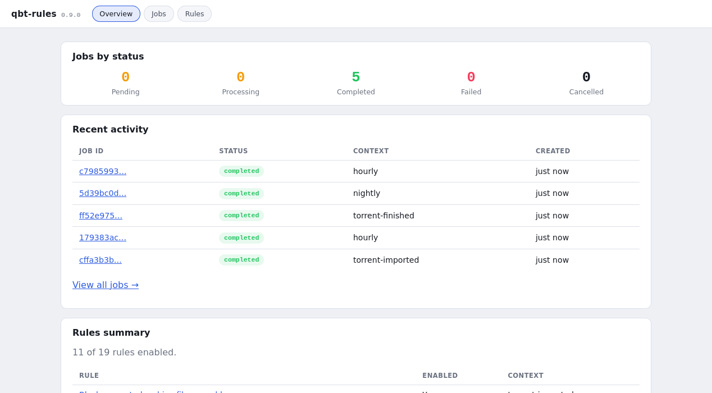

# qbt-rules

Rules for qBittorrent: write what should happen to your torrents in YAML, and qbt-rules keeps doing it, when a torrent is added, when it finishes, on a schedule, or whenever you ask.

[](https://github.com/andronics/qbt-rules/releases)
[](https://github.com/andronics/qbt-rules/pkgs/container/qbt-rules)
[](http://unlicense.org/)

```yaml
rules:
  - id: skip-sample-files
    meta:
      description: "Don't download sample files"
    context: torrent-imported          # run when qBittorrent adds a torrent
    conditions:
      all:
        - field: files.name
          operator: matches
          value: '(?i)(^|/)sample'
    actions:
      - type: set_file_priority
        params:
          priority: skip
          pattern: '(?i)(^|/)sample'
```

```yaml
# docker-compose.yml
services:
  qbt-rules:
    image: ghcr.io/andronics/qbt-rules:latest
    restart: unless-stopped
    ports: ["5000:5000"]
    volumes: ["./config:/config"]
    environment:
      QBT_RULES_QBITTORRENT_HOST: http://qbittorrent:8080
      QBT_RULES_QBITTORRENT_USERNAME: admin
      QBT_RULES_QBITTORRENT_PASSWORD: adminpass
      QBT_RULES_SERVER_API_KEY: change-me      # API + dashboard login
      QBT_RULES_DRY_RUN: "true"                # log what rules would do; set false when happy
```



**📖 [Documentation lives on the wiki](https://github.com/andronics/qbt-rules/wiki)**

---

## What is qbt-rules?

Left unattended, a qBittorrent instance turns into digital clutter: uncategorized downloads, dead torrents nobody's seeding anymore, ratio requirements quietly going unmet, the occasional file you really didn't want finishing before you noticed. qbt-rules automates all of that away — you write what you want to happen as declarative YAML, and it keeps enforcing it, whether that's the moment a torrent lands, on a schedule, or whenever you trigger it by hand.

**Key Features:**

- **Declarative YAML rules** — no coding required
- **Reusable references** — define a variable, condition, or action sequence once under `refs:`, reuse it everywhere ([docs](https://github.com/andronics/qbt-rules/wiki/Reusable-References))
- **Free-form execution contexts** — webhooks, cron sweeps, manual runs; no fixed trigger list ([docs](https://github.com/andronics/qbt-rules/wiki/Contexts))
- **Rich conditions** — AND/OR/NOT groups, 17+ operators, and [fields](https://github.com/andronics/qbt-rules/wiki/Available-Fields) from 8 qBittorrent API categories, plus fleet-wide `stats.*` and optional tracker-side `tracker.*` stats
- **Idempotent actions** — safe to run repeatedly
- **Dashboard** — jobs, results and rules at a glance, plus an in-browser `rules.yml` editor that validates as you type, on the same port as the API
- **Multi-version qBittorrent support** — v4.1 through v5.1+ via `qbittorrent-api`'s auto-detection

**How it works:** a small HTTP server, backed by a persistent SQLite or Redis job queue and a background worker, evaluates your rules and executes actions — categorize, tag, pause, resume, delete, throttle, skip files, notify — against qBittorrent. Jobs survive server restarts, and the whole thing ships as a single Docker image (amd64/arm64, GHCR) with no PyPI package or manual install for end users.

---

## Quick Start

### Prerequisites

- Docker and Docker Compose
- qBittorrent with Web UI enabled

### Start it

Save the `docker-compose.yml` above, set your qBittorrent address and credentials, and replace `change-me` with a long random string. To run as a specific user and group that owns `./config`, add `PUID` and `PGID` (default `1000`; Unraid uses `99`/`100`).

```bash
docker compose up -d
curl http://localhost:5000/api/health
```

Default `config.yml`/`rules.yml` are created in `./config` on first start. **The default rules include some that delete torrents** — read `rules.yml` before turning dry-run off.

### Your first rule

Edit `config/rules.yml`:

```yaml
rules:
  - id: auto-categorize-hd-movies
    meta:
      description: "Auto-categorize HD movies"
    enabled: true
    stop_on_match: true
    context: torrent-imported
    conditions:
      all:
        - field: info.name
          operator: matches
          value: '(?i).*(1080p|2160p|4k).*'
    actions:
      - type: set_category
        params:
          category: "Movies-HD"
      - type: add_tag
        params:
          tags: [hd, auto-categorized]
```

### Run it

```bash
# Run the torrent-imported rules now (a dry run while QBT_RULES_DRY_RUN is true)
docker compose exec qbt-rules qbt-rules --context torrent-imported --wait

# Once dry-run is off on the server, --dry-run still previews a single run
docker compose exec qbt-rules qbt-rules --dry-run --context torrent-imported --wait

# Or via the HTTP API
curl -X POST "http://localhost:5000/api/execute?context=torrent-imported&key=change-me"
```

Open `http://localhost:5000` for the dashboard (log in with the API key). When the results look right, set `QBT_RULES_DRY_RUN: "false"` and `docker compose up -d` again.

**Continue with the [Quick Start guide](https://github.com/andronics/qbt-rules/wiki/Quick-Start)** for the full walkthrough, including triggering rules from qBittorrent's "Run external program" setting, or jump to [Contexts](https://github.com/andronics/qbt-rules/wiki/Contexts) to understand how jobs get triggered.

---

## Documentation

Everything beyond getting started lives on the **[wiki](https://github.com/andronics/qbt-rules/wiki)**:

**Core Concepts**
[Rules Architecture](https://github.com/andronics/qbt-rules/wiki/Rules-Architecture) · [Contexts](https://github.com/andronics/qbt-rules/wiki/Contexts) · [Conditions](https://github.com/andronics/qbt-rules/wiki/Conditions) · [Actions](https://github.com/andronics/qbt-rules/wiki/Actions) · [Available Fields](https://github.com/andronics/qbt-rules/wiki/Available-Fields) · [Reusable References](https://github.com/andronics/qbt-rules/wiki/Reusable-References) · [HTTP API Reference](https://github.com/andronics/qbt-rules/wiki/HTTP-API-Reference)

**Security**
[Threat model, API auth, network exposure, credential management, content-safety rules](https://github.com/andronics/qbt-rules/wiki/Security)

**Configuration & Examples**
[In-Depth Configuration](https://github.com/andronics/qbt-rules/wiki/In‐Depth-Configuration) · [Examples](https://github.com/andronics/qbt-rules/wiki/Examples) · [Advanced Topics](https://github.com/andronics/qbt-rules/wiki/Advanced-Topics)

**Help**
[FAQ](https://github.com/andronics/qbt-rules/wiki/Frequently-Asked-Questions) · [Troubleshooting](https://github.com/andronics/qbt-rules/wiki/Troubleshooting)

**For Developers**
[Contributing](https://github.com/andronics/qbt-rules/wiki/Contributing) · [Architecture Internals](https://github.com/andronics/qbt-rules/wiki/Architecture-Internals) · [Extending the Engine](https://github.com/andronics/qbt-rules/wiki/Extending-the-Engine) · [Testing Guide](https://github.com/andronics/qbt-rules/wiki/Testing-Guide) · [Release Process](https://github.com/andronics/qbt-rules/wiki/Release-Process)

---

## Requirements

- **Docker** and Docker Compose (the only supported distribution method)
- **qBittorrent** with Web UI enabled
- **Optional:** a Redis server, if you choose `queue.backend: redis` over the SQLite default

---

## Changelog

See [CHANGELOG.md](CHANGELOG.md) for version history and release notes.

---

## Contributing

Contributions are welcome — see the wiki's [Contributing guide](https://github.com/andronics/qbt-rules/wiki/Contributing) for the full workflow (dev setup, code style, testing, and how to report issues or security vulnerabilities).

---

## License

This project is released into the **public domain** under the [Unlicense](http://unlicense.org/). You are free to use, modify, and distribute this software for any purpose without attribution.
